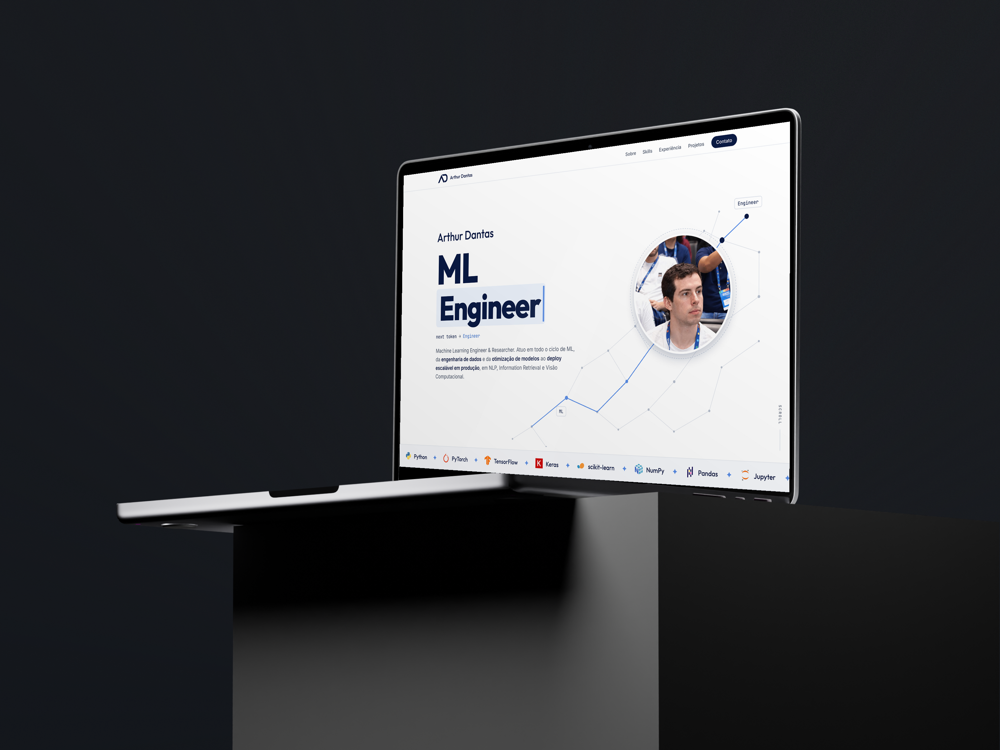

## :bulb: Projeto

Portfólio pessoal de Arthur Dantas, Machine Learning Engineer & Researcher. O site apresenta a trajetória, as áreas de atuação e os projetos em NLP, Information Retrieval e Visão Computacional, com prévias animadas de cada projeto, métricas e links para o código no GitHub e os modelos no Hugging Face.

- Versões em português (`/`) e inglês (`/en`), com seletor de idioma que mantém a seção atual
- Tema claro e escuro
- Animações de entrada e de rolagem que respeitam a preferência de movimento reduzido
- SEO com canonical, `hreflang` e sitemap para os dois idiomas



## :computer: Tecnologias

- **Next.js 15** (App Router) com páginas estáticas, **React 19** e **TypeScript**
- **Tailwind CSS**, com os tokens de cor do tema em variáveis CSS
- **Motion**, **GSAP** (carregado sob demanda) e **Lenis** para as animações e a rolagem suave
- **next-themes** para o tema claro e escuro

## :file_folder: Estrutura

```
app/
  (pt)/            rota "/" em português
  (en)/en/         rota "/en" em inglês
  _shell/          documento raiz, home, metadados e fontes
src/
  components/      seções e componentes compartilhados
  content/         textos em português e inglês e dados compartilhados
  types/           tipos do projeto
  config/          constantes do site e da interface
  styles/          estilos globais, classes reutilizáveis e CSS Modules
  i18n/            idiomas e provider de conteúdo
  lib/ · hooks/    utilitários e hooks
public/            imagens, ícones, robots e sitemap
```

Os textos ficam em `src/content/pt.ts` e `src/content/en.ts`, que seguem a mesma estrutura tipada.

## :arrow_forward: Executar

```bash
# Instala as dependências.
$ npm install

# Executa em modo de desenvolvimento.
$ npm run dev

# Verifica o código e gera a versão de produção.
$ npm run lint
$ npm run build
```
